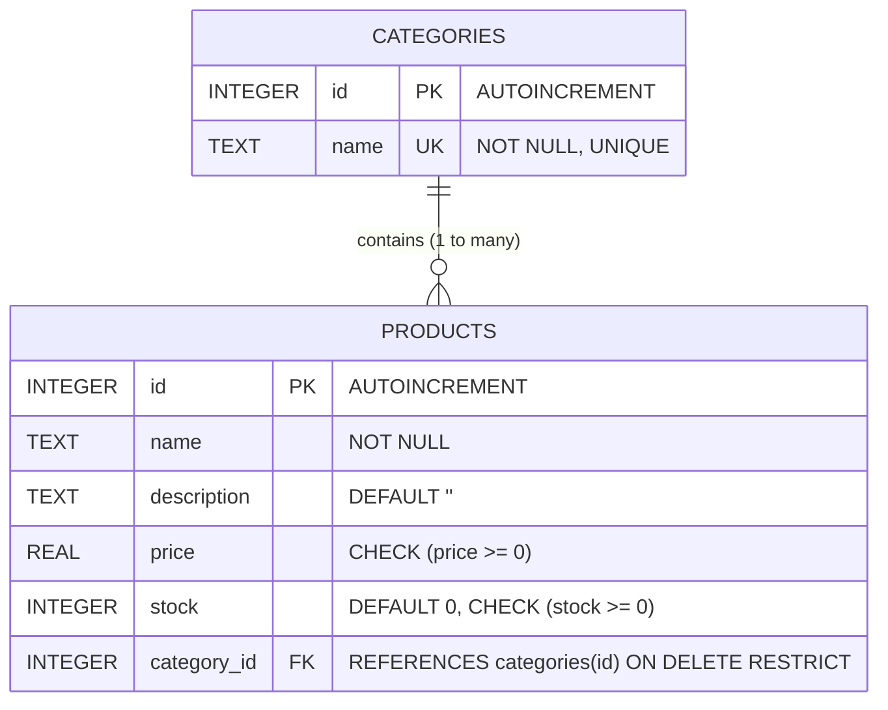

# E-commerce Product REST API

[](https://www.python.org/)
[](https://flask.palletsprojects.com/)
[](https://www.sqlite.org/)
[](http://127.0.0.1:5000/apidocs/)
[](tests/test_api.py)
[](LICENSE)

A production-ready, RESTful API built with **Python**, **Flask**, **SQLite**, and **Flasgger (OpenAPI/Swagger)**. Designed with clean route architecture, strict request validation, comprehensive JSON error handling, relational integrity, and automated unit testing.

---

## Table of Contents

- [Features](#features)
- [Architecture & Tech Stack](#architecture--tech-stack)
- [Database Schema & Data Models](#database-schema--data-models)
  - [Entity-Relationship Diagram](#entity-relationship-diagram)
  - [Categories Table](#1-categories-table)
  - [Products Table](#2-products-table)
- [API Endpoints Overview](#api-endpoints-overview)
  - [System & Discovery](#system--discovery)
  - [Category Endpoints](#category-endpoints)
  - [Product Endpoints](#product-endpoints)
- [Input Validation & Error Handling](#input-validation--error-handling)
- [Interactive API Documentation (Swagger)](#interactive-api-documentation-swagger)
- [Getting Started](#getting-started)
  - [Prerequisites](#prerequisites)
  - [Installation](#installation)
  - [Database Initialization & Seeding](#database-initialization--seeding)
  - [Running the Application](#running-the-application)
- [Running Automated Tests](#running-automated-tests)
- [Project Structure](#project-structure)
- [Exporting OpenAPI Specification](#exporting-openapi-specification)

---

## Features

- **Complete CRUD Operations**: Full Create, Read, Update, and Delete endpoints for both **Products** and **Categories**.
- **Partial Updates**: Support for `PATCH` requests to update individual product fields without resending the entire resource.
- **Relational Integrity**: Foreign key constraints with `ON DELETE RESTRICT` preventing orphan product records.
- **Advanced Query Filtering**: Filter products by search keywords (name and description), category ID, price range (`min_price`, `max_price`), and multi-attribute sorting (`price_asc`, `price_desc`, `name_asc`, `name_desc`, etc.).
- **Strict Input Validation**: Validates data types, non-empty strings, positive integers, non-negative numbers, and JSON payloads.
- **Pure JSON Error Responses**: Centralized HTTP error handlers ensuring 400, 404, 405, 409, and 500 always return structured JSON, never default HTML.
- **Interactive Swagger Documentation**: Built-in Swagger UI accessible directly at `/apidocs/` with testable endpoints.
- **Database Seeder**: Pre-configured `seed.py` utility that populates realistic catalog categories and items.
- **Comprehensive Test Suite**: Automated pytest suite verifying CRUD operations, edge cases, validation errors, and query filtering.

---

## Architecture & Tech Stack

- **Backend**: Python 3.12, Flask 3.1.3
- **Database**: SQLite 3 with Foreign Key enforcement (`PRAGMA foreign_keys = ON`) and query indexing
- **API Documentation**: Flasgger 0.9.7 (Swagger 2.0 / OpenAPI)
- **Testing**: Pytest 9.1
- **WSGI Production Server**: Gunicorn

---

## Database Schema & Data Models

### Entity-Relationship Diagram



### 1. Categories Table

Stores catalog classifications for organizing products.

| Column Name | SQLite Type | Constraints | Description |
|:---|:---|:---|:---|
| `id` | `INTEGER` | `PRIMARY KEY AUTOINCREMENT` | Unique category identifier |
| `name` | `TEXT` | `NOT NULL UNIQUE` | Category display name (case-insensitive uniqueness) |

### 2. Products Table

Stores product details and inventory counts, linked to parent categories.

| Column Name | SQLite Type | Constraints | Description |
|:---|:---|:---|:---|
| `id` | `INTEGER` | `PRIMARY KEY AUTOINCREMENT` | Unique product identifier |
| `name` | `TEXT` | `NOT NULL` | Product title/name |
| `description`| `TEXT` | `DEFAULT ''` | Descriptive overview of the product |
| `price` | `REAL` | `NOT NULL CHECK (price >= 0)` | Unit price in standard currency |
| `stock` | `INTEGER` | `NOT NULL DEFAULT 0 CHECK (stock >= 0)` | Quantity currently in stock |
| `category_id`| `INTEGER` | `NOT NULL, FOREIGN KEY (category_id) REFERENCES categories(id) ON DELETE RESTRICT` | Foreign key referencing the parent category |

#### Indexes
- `idx_products_category_id` on `products(category_id)`
- `idx_products_name` on `products(name)`

---

## API Endpoints Overview

All endpoints communicate using `application/json`. Detailed request/response documentation is available in [docs/API_DOCUMENTATION.md](file:///c:/Users/MYPC/Desktop/ecommerce-product-api/docs/API_DOCUMENTATION.md).

### System & Discovery

| Method | Endpoint | Description | Status Codes |
|:---|:---|:---|:---|
| `GET` | `/` | API welcome, version, and endpoint navigation | `200` |
| `GET` | `/api/health` | Service and database health check | `200`, `500` |

### Category Endpoints

| Method | Endpoint | Description | Status Codes |
|:---|:---|:---|:---|
| `GET` | `/api/categories` | Retrieve all categories with product counts | `200` |
| `GET` | `/api/categories/<id>` | Retrieve a single category by ID | `200`, `404` |
| `POST` | `/api/categories` | Create a new category | `201`, `400`, `409` |
| `PUT` | `/api/categories/<id>` | Update an existing category name | `200`, `400`, `404`, `409` |
| `DELETE` | `/api/categories/<id>` | Delete an empty category (protected by FK) | `200`, `404`, `409` |

### Product Endpoints

| Method | Endpoint | Description | Status Codes |
|:---|:---|:---|:---|
| `GET` | `/api/products` | List products (supports `search`, `category_id`, `min_price`, `max_price`, `sort`) | `200`, `400` |
| `GET` | `/api/products/<id>` | Retrieve a single product by ID | `200`, `404` |
| `POST` | `/api/products` | Create a new product | `201`, `400` |
| `PUT` | `/api/products/<id>` | Replace all fields of an existing product | `200`, `400`, `404` |
| `PATCH` | `/api/products/<id>` | Partially update specific fields of a product | `200`, `400`, `404` |
| `DELETE` | `/api/products/<id>` | Delete a product by ID | `200`, `404` |

---

## Input Validation & Error Handling

The API ensures strict validation on all requests:

1. **JSON Body Enforcement**: All mutating endpoints (`POST`, `PUT`, `PATCH`) require valid JSON objects. Non-JSON payloads or malformed syntax return `400 Bad Request`.
2. **Type Checking**:
   - `name`: Must be a non-empty string.
   - `price`: Must be a number (float or int), non-boolean, and `>= 0`.
   - `stock`: Must be an integer `>= 0`.
   - `category_id`: Must be a positive integer matching an existing record in `categories`.
3. **Foreign Key Integrity**:
   - Products cannot reference non-existent categories (`400 Bad Request`).
   - Categories cannot be deleted if products are associated with them (`409 Conflict`).
4. **Pure JSON Responses**: Global Flask error handlers capture all standard HTTP error codes:
   ```json
   {
     "error": "Resource not found"
   }
   ```

---

## Interactive API Documentation (Swagger)

When the application is running, open your browser and navigate to:

👉 **[http://127.0.0.1:5000/apidocs/](http://127.0.0.1:5000/apidocs/)**

Here, you can:
- Explore all endpoints grouped by tags (`General`, `Products`, `Categories`).
- Inspect request schemas and required fields.
- Execute "Try it out" requests interactively directly against your local database.
- View live response codes and payloads.

A raw OpenAPI JSON specification is also available at:
- `http://127.0.0.1:5000/apispec_1.json`
- Local file: [`swagger.json`](file:///c:/Users/MYPC/Desktop/ecommerce-product-api/swagger.json) or [`docs/openapi.json`](file:///c:/Users/MYPC/Desktop/ecommerce-product-api/docs/openapi.json)

---

## Getting Started

### Prerequisites

- **Python 3.10+** (Tested on Python 3.12)
- **pip** package manager

### Installation

1. **Clone the repository**:
   ```bash
   git clone https://github.com/Bindushreebl/ecommerce-product-api.git
   cd ecommerce-product-api
   ```

2. **Create and activate a virtual environment**:
   - On Windows (PowerShell):
     ```powershell
     python -m venv venv
     .\venv\Scripts\Activate.ps1
     ```
   - On macOS/Linux:
     ```bash
     python3 -m venv venv
     source venv/bin/activate
     ```

3. **Install dependencies**:
   ```bash
   pip install -r requirements.txt
   ```

### Database Initialization & Seeding

1. **Initialize tables**:
   ```bash
   python database.py
   ```
   *Output: `Database tables created successfully!`*

2. **(Optional) Seed sample data**:
   ```bash
   python seed.py
   ```
   *Populates initial categories (Electronics, Clothing, Books, Home, Sports) and 14 realistic products.*

### Running the Application

```bash
python app.py
```

The API will start listening at:
- API Root: `http://127.0.0.1:5000/`
- Swagger UI: `http://127.0.0.1:5000/apidocs/`
- Health Check: `http://127.0.0.1:5000/api/health`

---

## Running Automated Tests

A comprehensive test suite with 12 automated test cases is included in [`tests/test_api.py`](file:///c:/Users/MYPC/Desktop/ecommerce-product-api/tests/test_api.py). Tests execute using an isolated temporary SQLite database without modifying your development database.

Run all tests with verbose output:

```bash
pytest -v
```

Expected output:
```text
tests/test_api.py::test_home_endpoint PASSED                             [  8%]
tests/test_api.py::test_health_check PASSED                              [ 16%]
tests/test_api.py::test_404_json_error PASSED                            [ 25%]
tests/test_api.py::test_405_json_error PASSED                            [ 33%]
tests/test_api.py::test_category_crud_lifecycle PASSED                   [ 41%]
tests/test_api.py::test_category_validation PASSED                       [ 50%]
tests/test_api.py::test_product_crud_lifecycle PASSED                    [ 58%]
tests/test_api.py::test_product_validation PASSED                        [ 66%]
tests/test_api.py::test_foreign_key_delete_protection PASSED             [ 75%]
tests/test_api.py::test_product_filtering_and_sorting PASSED             [ 83%]
tests/test_api.py::test_category_product_count_and_same_name_update PASSED [ 91%]
tests/test_api.py::test_individual_patch_fields PASSED                   [100%]

============================= 12 passed in 1.61s ==============================
```

---

## Project Structure

```text
ecommerce-product-api/
│
├── app.py                   # Main Flask application, routes, and Swagger configuration
├── database.py              # SQLite connection helper, PRAGMA foreign keys, and DDL schema
├── seed.py                  # Seed script for demo categories and products
├── requirements.txt         # Project dependencies (Flask, Flasgger, Pytest, Gunicorn)
├── swagger.json             # Exported OpenAPI 2.0 / Swagger specification
├── README.md                # Project documentation and architecture guide
│
├── docs/                    # Technical documentation
│   ├── API_DOCUMENTATION.md # Comprehensive endpoint reference and cURL examples
│   └── openapi.json         # Standalone OpenAPI specification
│
├── tests/                   # Automated test suite
│   └── test_api.py          # Pytest cases covering CRUD, validation, FK, and filters
│
└── .gitignore               # Ignored files (venv, *.db, cache, .vscode)
```

---

## Exporting OpenAPI Specification

If you make modifications to endpoints or schemas, regenerate the static OpenAPI specification files by running:

```bash
python -c "import os, json; from app import app; client = app.test_client(); res = client.get('/apispec_1.json'); data = res.get_json(); os.makedirs('docs', exist_ok=True); open('swagger.json', 'w', encoding='utf-8').write(json.dumps(data, indent=2)); open('docs/openapi.json', 'w', encoding='utf-8').write(json.dumps(data, indent=2)); print('OpenAPI spec refreshed!')"
```

---

## License

This project is licensed under the MIT License.

https://ecommerce-product-api-1-bcqx.onrender.com
